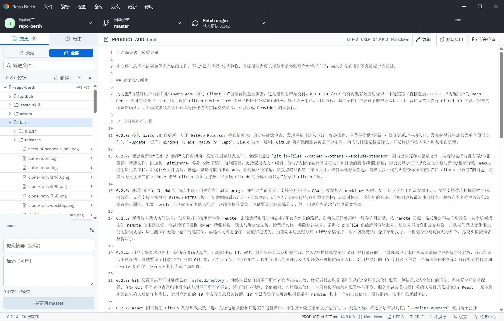
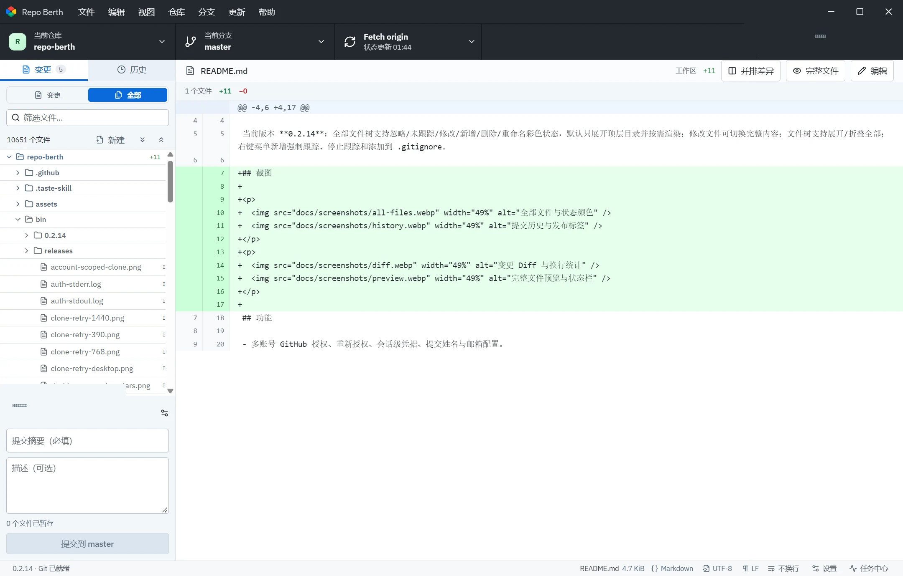
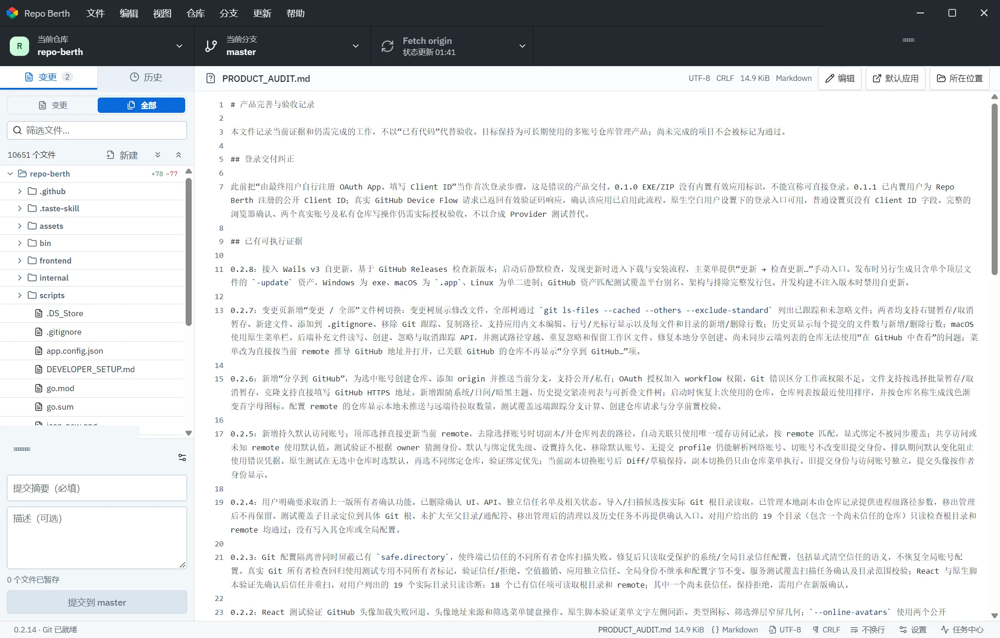

# Repo Berth

基于 **Wails 3.0.0 + Go + React / TypeScript** 的多账号 Git 仓库桌面工具，目前支持 GitHub。每个本地副本可以独立绑定访问账号与提交身份，仓库 owner 不会用于推断当前登录账号。

当前版本 **0.2.18**：遵循 Git 换行符配置，过滤纯换行符噪声；未编辑文件保留原始字节与修改时间，换行符调整有消息记录；新通知在右下角显示，超时收起，任务中心不再自动展开。

## 截图

<p>
  
  
</p>
<p>
  
</p>

## 功能

- 多账号 GitHub 授权、重新授权、会话级凭据、提交姓名与邮箱配置。
- 云端仓库同步、访问关系合并、搜索、收藏、分组和最近访问。
- 本地仓库导入、目录扫描、多个本地副本、worktree 与普通目录管理。
- 检测损坏的 `.git` 元数据，并把无法读取的本地副本安全移出管理（不删除文件）。
- 仓库菜单支持“用命令行打开”，可在设置中选择默认命令行程序。
- 变更/全部文件树、暂存、提交、分支切换、Fetch / Pull / Push、提交历史。
- 新消息在右下角单条提示，5 秒后自动收起，悬停或聚焦时暂停；任务中心保持收起并保留记录与未读计数，失败转红，可一键全部已读。
- 文件编码与换行符状态栏、文本/图片/音频/视频/二进制预览。
- 文件树复制、剪切、删除、重命名、新建文件或目录、终端与 VS Code 打开。
- 统一 Diff、双栏 Diff、语法高亮、自动换行和带行号编辑器。
- 第三方许可文本压缩内嵌，可在应用“关于 → 第三方许可”查看。
- 应用内自更新。更新提示窗口置顶并以模态显示，避免被主窗口遮挡；更新器只使用 GitHub Release 中的 `*-update.zip` 资产。

## 跨平台换行符

应用遵循 Git 的系统、全局和仓库换行符配置（`core.autocrlf`、`core.eol`、`core.safecrlf`），由原生 Git 和 `.gitattributes` 决定转换规则。账号、凭据及其他系统/全局配置仍保持隔离。应用不自行重写暂存区内容。纯换行符的未暂存差异会从变更列表过滤；外部工具明确暂存的修改仍显示，提交时保留用户选择。

预览只读；保存时正文没有实际变化的文件保留原始字节与修改时间。编辑保存沿用文件原有 LF/CRLF，新增文件及编辑过的混合换行符文件默认使用 LF。实际发生的文件换行符调整和 Git 暂存转换会通过右下角消息提示，并在任务中心保留记录；暂存转换提示会明确标注工作文件保持原样。

建议跨 Windows/macOS 的项目在仓库根目录提交 `.gitattributes`，让所有 Git 客户端共享规则：

```gitattributes
* text=auto eol=lf
*.bat text eol=crlf
*.cmd text eol=crlf
```

这样普通文本签出为 LF，Windows 批处理脚本签出为 CRLF，Git 仓库中的文本统一存为 LF。编辑器可再通过 `.editorconfig` 的 `end_of_line = lf` 保持保存格式。已有历史文件的整体归一化可单独通过 `git add --renormalize .` 审核、提交。

## 下载

- Windows：`RepoBerth-<version>-windows-amd64-update.zip`，解压后运行 `RepoBerth.exe`。需要 Git 与 WebView2。
- macOS Apple Silicon：`RepoBerth-<version>-macos-arm64-update.zip`。
- 同一个包既用于手动下载，也用于应用内更新；每个平台只发布一个压缩包和 `.sha256`。

版本历史、下载地址和校验值请查看 [GitHub Releases](https://github.com/firmme/repo-berth/releases)。

## 构建

需要 Go **1.27.2+**、Node.js **24** 和 Git。依赖版本由 `go.sum` 与 `frontend/package-lock.json` 固定。

```powershell
npm ci --prefix frontend
node scripts/build.mjs
.\bin\<version>\RepoBerth.exe
```

构建脚本会自动生成压缩的第三方许可清单并嵌入二进制。Windows 构建需要 MinGW `windres` 生成 EXE 图标资源，可通过 `WINDRES` 指定路径。macOS 需要 Xcode Command Line Tools；Linux 需要 GTK4、WebKitGTK 6.0、X11 和 Secret Service。开发配置见 [DEVELOPER_SETUP.md](DEVELOPER_SETUP.md)。

## 发布资产

每个平台只发布一个 `*-update.zip` 和一个 `.sha256`：

```powershell
node scripts/package-update.mjs
```

压缩包只包含一个顶层可执行文件或 `.app`，既满足更新器要求，也可直接解压运行。第三方许可、README 和依赖清单已压缩嵌入应用，发布时不再附带额外文件。`node scripts/package-windows.mjs` 仅保留用于生成完整开发验收包。

macOS 同理生成 `*-macos-*-update.zip`。所有压缩包同时上传对应的 `.sha256`。

## 验证

```powershell
node scripts/build.mjs
go test ./...
go vet ./...
npm test --prefix frontend
```

第三方许可由 `node scripts/generate-notices.mjs` 生成并压缩嵌入；`node scripts/build.mjs` 会自动执行。CI 在 Windows、macOS 和 Ubuntu 上运行构建与测试。

## 数据与安全

- Token 只存在于 Go 内存和系统凭据库，不进入 React、SQLite、remote URL、命令行参数或日志。
- 每个网络命令使用独立 loopback 凭据通道和随机 nonce。
- Git 子进程隔离继承的 `GIT_*`、系统/全局配置和凭据助手链；只读取换行符设置白名单与显式的 `safe.directory` 信任，应用不写全局 Git 配置。
- 应用内提交不启用 GPG / SSH 签名，不递归克隆 submodule，不自动下载 Git LFS 对象。
- 数据库位置：Windows `%APPDATA%/RepoBerth/berth.db`，macOS `~/Library/Application Support/RepoBerth/berth.db`，Linux `$XDG_CONFIG_HOME/RepoBerth/berth.db`。

更完整的产品边界与验收记录见 [PRODUCT_AUDIT.md](PRODUCT_AUDIT.md)。

## 代码结构

```text
main.go              Wails 入口、原生目录选择和外部工具
internal/model       共享数据类型
internal/store       SQLite 存储
internal/vault       系统凭据库和会话凭据
internal/provider    GitHub API / Device Flow
internal/gitexec     Git 执行、凭据隔离、状态与历史
internal/service     账号、仓库、Git 和任务业务逻辑
frontend/src         React 桌面界面
scripts              构建、打包和验证脚本
```
